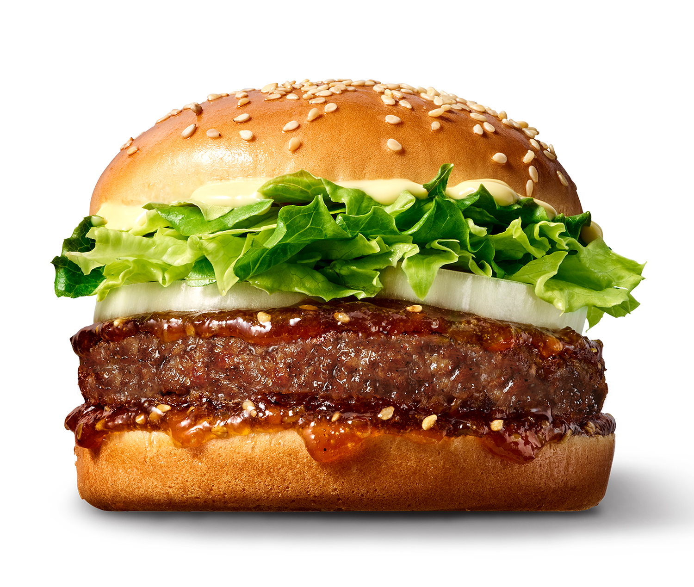
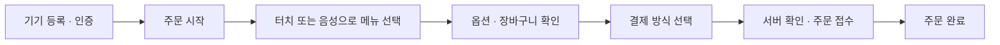

<div align="center">

# 🍔 BurgerKiosk

**터치로 고르고, 목소리로 주문하는 버거 키오스크**

메뉴 선택부터 주문 접수, 관리자 운영까지 연결하는 Windows WPF 애플리케이션




[주요 기능](#-주요-기능) · [실행 방법](#-실행-방법) · [프로젝트 구조](#-프로젝트-구조)

</div>

---

## 📌 프로젝트 소개

BurgerKiosk는 C#과 WPF로 구현한 버거 주문 키오스크입니다. 화면을 조작하는 주문 방식과 Gemini Live 기반 실시간 음성 주문을 제공하며, Supabase와 연동해 상품 조회, 주문 접수, 기기 인증과 관리자 기능을 처리합니다.

고객용 주문 화면과 관리자용 운영 화면을 하나의 데스크톱 프로젝트에 구성했습니다.

## ✨ 주요 기능

| 영역 | 구현 내용 |
| --- | --- |
| 🍟 메뉴 주문 | 상품 조회, 옵션 선택, 장바구니 수량 변경 및 주문 금액 확인 |
| 🎙️ AI 음성 주문 | 마이크 입력과 Gemini Live를 이용한 실시간 음성 대화 및 주문 도구 호출 |
| 💳 결제 흐름 | WebView2 기반 카카오페이 결제 페이지 표시, 서버 상태 조회, 진행 중 결제 복구 |
| 🧾 주문 접수 | 서버 연동 주문 생성 및 주문 완료 화면 표시 |
| 🎁 포인트 회원 | 전화번호 기반 회원 조회와 관리자 회원 등록·목록 조회 |
| 🛠️ 관리자 | 관리자 인증, 재고 관리, 메뉴 관리, 주문 통계 및 주문 취소 |
| 🔐 기기 등록 | 등록된 키오스크 기기 확인 및 Windows 사용자별 암호화 세션 저장 |

> **결제 안내:** 카드 결제는 실제 카드 승인이 없는 데모 주문 접수입니다. 카카오페이는 별도 서버 함수와 결제 환경 설정이 필요하며, 이 저장소만으로 실제 결제 운영이 준비되는 것은 아닙니다.

## 🔄 주문 흐름



## 🧰 기술 구성

| 구분 | 기술 |
| --- | --- |
| 언어 / 실행 환경 | C#, .NET 8, Windows |
| UI | WPF, XAML |
| 화면 구성 | View / ViewModel / Model 분리, 데이터 바인딩, ICommand |
| 백엔드 연동 | Supabase C# SDK, HTTP API, RPC, Edge Functions |
| 실시간 음성 | Gemini Live, WebSocket, NAudio |
| 결제 페이지 | Microsoft Edge WebView2 |

NuGet 패키지 버전은 `BurgerKiosk/BurgerKiosk.csproj`에서 확인할 수 있습니다.

## 🚀 실행 방법

### 준비 환경

- Windows 및 .NET 8 SDK
- Visual Studio 2022에서 실행할 경우 **.NET 데스크톱 개발** 워크로드
- Microsoft Edge WebView2 Runtime
- 음성 주문 사용 시 마이크와 오디오 출력 장치
- 상품 데이터, 기기 계정 및 필요한 서버 API가 준비된 Supabase 프로젝트

### 1. 소스 가져오기

```bash
git clone https://github.com/baeseojin/BurgerKiosk.git
cd BurgerKiosk
```

### 2. 백엔드 연결 확인

`BurgerKiosk/App.xaml.cs`의 프로젝트 URL과 publishable key를 사용할 Supabase 프로젝트에 맞게 설정합니다. 첫 실행에는 서버에서 허용된 키오스크 기기 계정으로 등록해야 합니다.

이 저장소에는 **WPF 클라이언트 소스**가 포함되어 있습니다. 데이터베이스 스키마, RPC 정의, Edge Functions 구현 및 외부 서비스 설정은 별도로 준비해야 합니다. 따라서 복제 후 빌드하더라도 백엔드 준비 없이 전체 기능을 실행할 수는 없습니다.

| 연동 영역 | 클라이언트가 사용하는 서버 기능 예시 |
| --- | --- |
| 상품 / 기기 | `products`, `registered_kiosk_device_info` |
| 음성 연결 | `create-live-token` |
| 주문 | `create-order` |
| 카카오페이 | `kakaopay-ready` 및 결제 상태·취소 관련 함수 |
| 관리자 / 회원 | `is_kiosk_admin`, 재고·메뉴·통계·주문 취소 RPC, `loyalty-member` |

서버 API의 요청·응답 형식은 `Services/`와 `Admin/`의 호출 코드를 기준으로 확인할 수 있습니다. 외부 서비스의 비밀키는 서버에서 관리합니다.

### 3. 빌드 및 실행

Visual Studio에서 `BurgerKiosk.sln`을 열고 시작 프로젝트를 `BurgerKiosk`로 지정한 뒤 실행합니다. 터미널에서도 실행할 수 있습니다.

```bash
dotnet restore BurgerKiosk.sln
dotnet build BurgerKiosk.sln
dotnet run --project BurgerKiosk/BurgerKiosk.csproj
```

기기 계정을 다시 등록하려면 다음 옵션을 사용합니다.

```bash
dotnet run --project BurgerKiosk/BurgerKiosk.csproj -- --register-device
```

## 📁 프로젝트 구조

```text
BurgerKiosk/
├── BurgerKiosk.sln
├── README.md
└── BurgerKiosk/
    ├── App.xaml.cs                # 시작 처리와 기기 등록
    ├── MainWindow.xaml            # 메인 화면
    ├── Admin/                     # 관리자 화면과 운영 서비스
    ├── Behaviors/                 # 스크롤 드래그 등 UI 동작
    ├── Commands/                  # ICommand 구현
    ├── Images/                    # 메뉴 이미지
    ├── Models/                    # 상품과 장바구니 모델
    ├── Services/                  # 주문·음성·결제·인증 연동
    ├── ViewModels/                # 화면 상태와 주문 흐름
    └── Views/                     # 홈·주문·옵션·결제 등 화면
```

## 💡 구현 포인트

- **터치와 음성의 연결:** 음성 대화에서 주문 도구를 호출해 화면의 주문 흐름과 연결합니다.
- **결제 상태 복구:** 시작 시 미완료 결제를 확인하고 서버 상태에 따라 후속 처리를 진행합니다.
- **기기 세션 보호:** 확인된 기기 세션을 Windows DPAPI로 암호화해 저장합니다.
- **고객과 관리자 화면 구성:** 고객 주문 기능과 매장 운영 기능을 한 프로젝트에서 제공합니다.

## 📦 저장소 관리

소스와 메뉴 이미지를 관리하며, 다시 생성되는 `bin/`, `obj/`, `.vs/` 및 사용자별 IDE 설정은 `.gitignore`로 제외합니다.

---

<div align="center">

**BurgerKiosk · C# WPF 기반 터치 & AI 음성 주문 프로젝트**

</div>
